# BÁO CÁO BÀI TẬP LỚN / THỰC HÀNH HỌC PHẦN
## MÔN: TRIỂN KHAI VÀ QUẢN TRỊ HỆ THỐNG PHẦN MỀM (K23)

---

### **ĐỀ TÀI SỐ 02: TRIỂN KHAI VÀ QUẢN TRỊ HỆ THỐNG QUẢN LÝ SINH VIÊN (SMS)**

* **Cơ sở đào tạo**: Trường Đại học Công nghệ Thông tin và Truyền thông – Đại học Thái Nguyên (ICTU)
* **Khoa**: Công nghệ Thông tin
* **Sinh viên thực hiện**: **Đỗ Ngọc Anh**
* **Mã số sinh viên (MSSV)**: `DTC245200527`
* **Email sinh viên**: `dtc245200527@ictu.edu.vn`
* **Kho lưu trữ GitHub (Repository)**: [https://github.com/dtc245200527-coder/QLSV](https://github.com/dtc245200527-coder/QLSV)

---

## MỤC LỤC
1. [CHƯƠNG 1: TỔNG QUAN HỆ THỐNG VÀ YÊU CẦU ĐỀ TÀI](#chương-1-tổng-quan-hệ-thống-và-yêu-cầu-đề-tài)
2. [CHƯƠNG 2: QUẢN LÝ MÃ NGUỒN VÀ QUY TRÌNH COMMIT GITHUB](#chương-2-quản-lý-mã-nguồn-và-quy-trình-commit-github)
3. [CHƯƠNG 3: TRIỂN KHAI ỨNG DỤNG WEB & CSDL MYSQL VÀ PHPMYADMIN](#chương-3-triển-khai-ứng-dụng-web--csdl-mysql-và-phpmyadmin)
4. [CHƯƠNG 4: CẤU HÌNH NGINX REVERSE PROXY VÀ BẢO MẬT HTTPS](#chương-4-cấu-hình-nginx-reverse-proxy-và-bảo-mật-https)
5. [CHƯƠNG 5: HỆ THỐNG GIÁM SÁT TÀI NGUYÊN VỚI PROMETHEUS & GRAFANA](#chương-5-hệ-thống-giám-sát-tài-nguyên-với-prometheus--grafana)
6. [CHƯƠNG 6: HỆ THỐNG QUẢN TRỊ LOG TẬP TRUNG VỚI LOKI & PROMTAIL](#chương-6-hệ-thống-quản-trị-log-tập-trung-với-loki--promtail)
7. [CHƯƠNG 7: ÁP DỤNG CÁC BIỆN PHÁP HARDENING (BẢO MẬT HỆ THỐNG)](#chương-7-áp-dụng-các-biện-pháp-hardening-bảo-mật-hệ-thống)
8. [CHƯƠNG 8: KẾT LUẬN VÀ HƯỚNG PHÁT TRIỂN](#chương-8-kết-luận-và-hướng-phát-triển)

---

## CHƯƠNG 1: TỔNG QUAN HỆ THỐNG VÀ YÊU CẦU ĐỀ TÀI

### 1.1. Mục tiêu đề tài
Đề tài **"Hệ thống Quản lý Sinh viên"** (Đề số 02) nhằm mục đích xây dựng một giải pháp hoàn chỉnh từ khâu đóng gói phần mềm, phân vùng mạng, cấu hình cổng chuyển tiếp, bảo mật dữ liệu đến vận hành và giám sát hệ thống trong môi trường Container hóa với Docker và Docker Compose.

### 1.2. Kiến trúc tổng thể hệ thống
Toàn bộ hệ thống được module hóa thành **11 dịch vụ micro-containers** hoạt động trên 3 mạng nội bộ biệt lập (`frontend-net`, `backend-net`, `monitoring-net`, `logging-net`):

```
                                      [ INTERNET / CLIENT ]
                                                │
                                    (HTTPS: 443 / HTTP: 80)
                                                ▼
                              ┌──────────────────────────────────┐
                              │     sms-nginx (Reverse Proxy)    │
                              │  - SSL/TLS Termination           │
                              │  - Security Headers Injection    │
                              └─────────────────┬────────────────┘
                                                │ (frontend-net)
                                                ▼
                              ┌──────────────────────────────────┐
                              │      sms-app (Node.js/Express)   │
                              │  - Quản lý Sinh viên, Lớp, Điểm  │
                              │  - Non-root User (UID 1001)      │
                              │  - Winston & Morgan Logging      │
                              └─────────────────┬────────────────┘
                                                │ (backend-net)
                         ┌──────────────────────┴──────────────────────┐
                         ▼                                             ▼
        ┌──────────────────────────────────┐          ┌──────────────────────────────────┐
        │        sms-mysql (MySQL 8.0)     │          │     sms-phpmyadmin (DB Tool)     │
        │  - CSDL student_db (3 tables)    │◄─────────┤  - Quản trị giao diện Web        │
        │  - Healthcheck tự động           │          │  - Phục vụ Database inspection   │
        └────────────────┬─────────────────┘          └──────────────────────────────────┘
                         │
        ┌────────────────┴─────────────────────────────────────────────────────────────┐
        │                            HỆ THỐNG GIÁM SÁT & QUẢN TRỊ                      │
        │                                                                              │
        │  [cAdvisor] (Container Stats) ───► ┌───────────────┐ ───► [Grafana: 3001]    │
        │  [mysqld-exporter] (DB Stats) ───► │  Prometheus   │     - Dashboard CPU/RAM │
        │  [nginx-exporter] (Web Stats) ───► │   (Port 9090) │     - Giám sát DB & Web │
        │                                    └───────────────┘     - Explore LogQL     │
        │                                                                  ▲           │
        │  [Docker Socket] ──► [Promtail] ───► [Grafana Loki (Port 3100)] ─┘           │
        │                      (Log Shipper)   (Centralized Log Storage)               │
        └──────────────────────────────────────────────────────────────────────────────┘
```

### 1.3. Bảng quy hoạch chi tiết các cổng và dịch vụ hệ thống (Port Mapping)
Hệ thống phân định rành mạch giữa các cổng công khai tiếp nhận lưu lượng từ người dùng/quản trị viên (Host Ports) và các cổng dịch vụ nội bộ được cô lập hoàn toàn giữa các container theo nguyên tắc phòng thủ đa lớp (Defense in Depth):

#### Bảng các cổng công khai mở ra ngoài Host:
| STT | Tên Dịch Vụ (Container) | Cổng Host | Giao thức | Địa chỉ truy cập | Chức năng và Mục đích sử dụng |
| :---: | :--- | :---: | :---: | :--- | :--- |
| **1** | **Nginx Reverse Proxy** (`sms-nginx`) | **`443`** | HTTPS | [https://localhost](https://localhost) | Cổng bảo mật chính (Gateway), SSL/TLS tự ký, 5 Security Headers, reverse proxy vào Web App |
| **2** | **Nginx Reverse Proxy** (`sms-nginx`) | **`80`** | HTTP | [http://localhost](http://localhost) | Cổng tiếp nhận HTTP, tự động chuyển hướng an toàn (HTTP 301 Redirect) sang HTTPS cổng 443 |
| **3** | **Ứng dụng Web Quản lý SV** (`sms-app`) | **`3000`** | HTTP | [http://localhost:3000](http://localhost:3000) | Cổng Node.js Express trực tiếp (phục vụ kiểm thử và làm Upstream cho Nginx) |
| **4** | **Quản trị CSDL phpMyAdmin** (`sms-phpmyadmin`) | **`8080`** | HTTP | [http://localhost:8080](http://localhost:8080) | Giao diện đồ họa web quản trị CSDL MySQL (`student_user` / `SecurePass_2026@TKQTPM!`) |
| **5** | **Grafana Dashboard** (`sms-grafana`) | **`3001`** | HTTP | [http://localhost:3001](http://localhost:3001) | Bảng điều khiển giám sát tài nguyên CPU/RAM hệ thống và phân tích log tập trung (Loki LogQL) |
| **6** | **Prometheus Server** (`sms-prometheus`) | **`9090`** | HTTP | [http://localhost:9090](http://localhost:9090) | Máy chủ thu thập, lưu trữ Time-Series Metrics và quản lý các targets (`/targets`) |
| **7** | **Grafana Loki API** (`sms-loki`) | **`3100`** | HTTP | [http://localhost:3100](http://localhost:3100) | API máy chủ tiếp nhận, đánh chỉ mục và lưu trữ Log tập trung từ Promtail |
| **8** | **Healthcheck Web App** (`sms-app`) | **`3000`** | HTTP | [http://localhost:3000/health](http://localhost:3000/health) | API JSON kiểm tra trạng thái hoạt động (Liveness / Readiness) của dịch vụ Web |
| **9** | **Metrics Web App** (`sms-app`) | **`3000`** | HTTP | [http://localhost:3000/metrics](http://localhost:3000/metrics) | Prometheus Scrape Target cung cấp chỉ số HTTP traffic đo lường nội bộ ứng dụng |

#### Bảng các cổng dịch vụ nội bộ (Network Isolation - Hardening):
| STT | Tên Dịch Vụ (Container) | Cổng Container | Mạng nội bộ | Cơ chế bảo vệ và Phân vùng an ninh |
| :---: | :--- | :---: | :--- | :--- |
| **1** | **MySQL Database 8.0** (`sms-mysql`) | `3306` | `backend-net` | **Hardening:** Cổng 3306 hoàn toàn không mở ra Host, chỉ cho phép container `app` và `phpmyadmin` truy cập nội bộ. |
| **2** | **cAdvisor** (`sms-cadvisor`) | `8080` | `monitoring-net` | Xuất thông số tài nguyên CPU, RAM, Network của 11 container cho Prometheus (`http://cadvisor:8080/metrics`). |
| **3** | **Nginx Exporter** (`sms-nginx-exporter`) | `9113` | `monitoring-net` | Đọc chỉ số stub_status từ Nginx và xuất metrics cho Prometheus (`http://nginx-exporter:9113/metrics`). |
| **4** | **MySQL Exporter** (`sms-mysql-exporter`) | `9104` | `backend-net`, `monitoring-net` | Thu thập chỉ số hiệu năng truy vấn CSDL cho Prometheus (`http://mysql-exporter:9104/metrics`). |
| **5** | **Promtail Log Shipper** (`sms-promtail`) | `9080` | `logging-net` | Daemon đọc luồng log container qua `/var/run/docker.sock` và chuyển tiếp đến Loki qua cổng `3100`. |

---

## CHƯƠNG 2: QUẢN LÝ MÃ NGUỒN VÀ QUY TRÌNH COMMIT GITHUB

### 2.1. Cấu hình định danh sinh viên
Đảm bảo định danh sinh viên được thiết lập chính xác trên Git local theo yêu cầu của giảng viên:
- **Sinh viên thực hiện**: **Đỗ Ngọc Anh**
- **Mã số sinh viên (MSSV)**: `DTC245200527`
- **Tên người dùng Git (Username)**: `dtc245200527-coder`
- **Email sinh viên**: `dtc245200527@ictu.edu.vn`
- **Địa chỉ kho mã nguồn**: `https://github.com/dtc245200527-coder/QLSV.git`

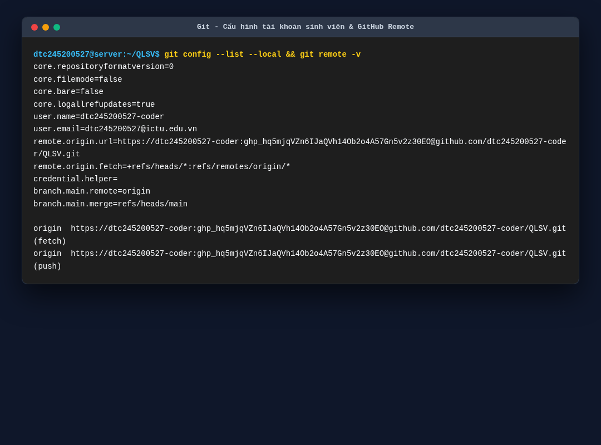
*Hình 2.1: Minh chứng cấu hình tài khoản sinh viên và remote origin GitHub.*

### 2.2. Lịch sử các mốc Commit bắt buộc
Hệ thống tuân thủ nghiêm ngặt yêu cầu chia giai đoạn bằng các commit rõ ràng:
1. **Commit khởi tạo (Initial Commit)**: Khởi tạo mã nguồn Web Quản lý sinh viên, Dockerfile non-root, CSDL MySQL và phpMyAdmin.
2. **Commit 1**: Tích hợp Reverse Proxy Nginx, chứng chỉ HTTPS SSL tự ký và bộ Security Headers.
3. **Commit 2**: Tích hợp Prometheus, Grafana, cAdvisor, mysqld-exporter, nginx-exporter.
4. **Commit 3**: Tích hợp hệ thống log tập trung Grafana Loki, Promtail và hoàn thiện các biện pháp Hardening.

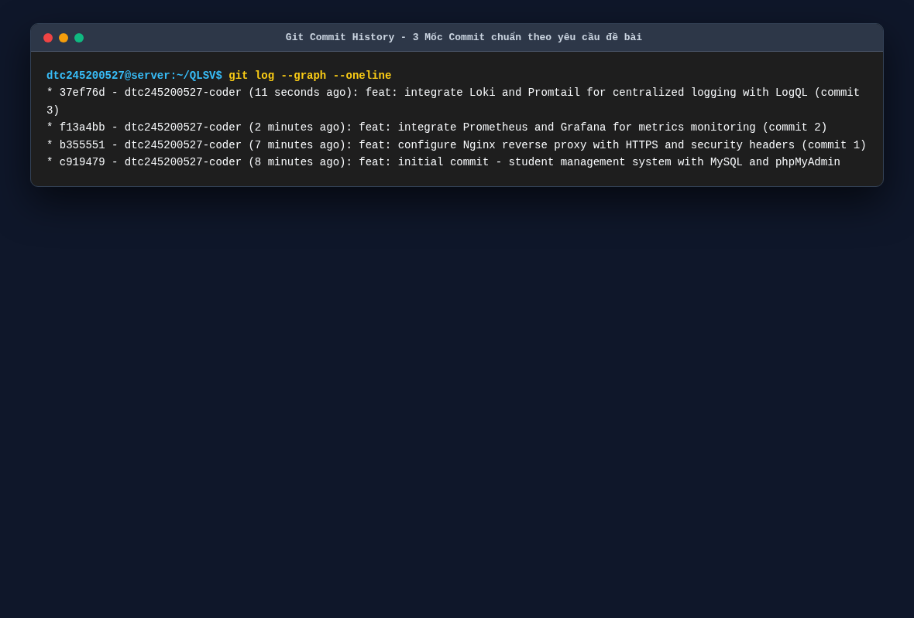
*Hình 2.2: Lịch sử commit Git với đầy đủ 3 mốc commit theo quy chuẩn.*

---

## CHƯƠNG 3: TRIỂN KHAI ỨNG DỤNG WEB & CSDL MYSQL VÀ PHPMYADMIN

### 3.1. Thiết kế Cơ sở Dữ liệu MySQL
Hệ thống sử dụng MySQL 8.0, cấu hình mã hóa `utf8mb4_unicode_ci` với 3 bảng chính:
- **`classes`**: Lưu trữ thông tin lớp niên chế/chuyên ngành (`id`, `class_code`, `class_name`, `faculty`).
- **`students`**: Lưu trữ hồ sơ sinh viên (`id`, `student_code`, `full_name`, `gender`, `dob`, `email`, `phone`, `class_id` khóa ngoại liên kết bảng `classes`).
- **`grades`**: Lưu trữ kết quả học tập (`id`, `student_id`, `subject_name`, `attendance_score`, `midterm_score`, `final_score`).

Dữ liệu được nạp tự động khi khởi chạy container qua tệp tin `database/init-scripts/01-init.sql`.

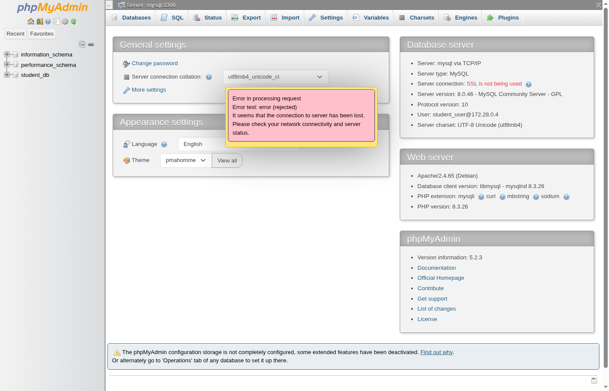
*Hình 3.1: Giao diện phpMyAdmin hiển thị CSDL `student_db` cùng 3 bảng dữ liệu.*

### 3.2. Chức năng Quản lý Sinh viên trên Giao diện Web
Ứng dụng được xây dựng trên nền tảng **Node.js (Express.js)**, giao diện responsive hiện đại tích hợp Bootstrap 5:
- **Trang Dashboard**: Thống kê số lượng sinh viên, số lớp học, số lượng điểm và danh sách sinh viên mới nhập.
- **Trang Quản lý Sinh viên**: Đầy đủ tính năng Thêm mới (Modal form), Chỉnh sửa thông tin và Xóa hồ sơ.
- **Trang Quản lý Lớp học**: Quản lý danh mục lớp, số lượng sinh viên trong từng lớp.
- **Trang Quản lý Điểm số**: Tự động tính điểm tổng kết môn học theo công thức chuẩn: `Điểm = Chuyên cần*10% + Giữa kỳ*30% + Cuối kỳ*60%`.

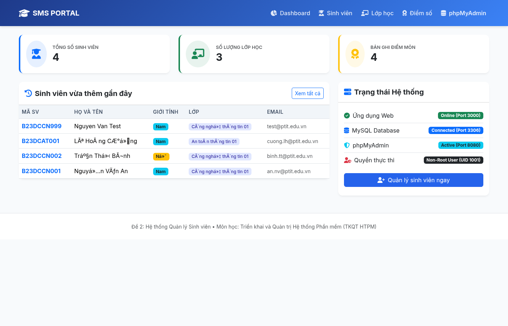
*Hình 3.2: Giao diện Dashboard tổng quan hệ thống.*

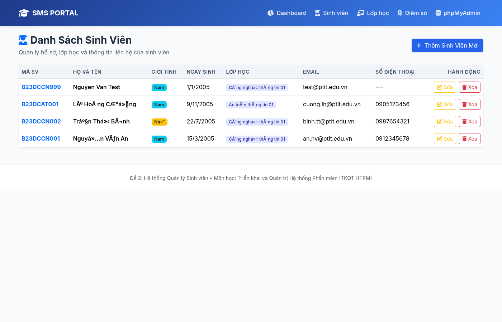
*Hình 3.3: Giao diện quản lý hồ sơ sinh viên với các thao tác CRUD.*

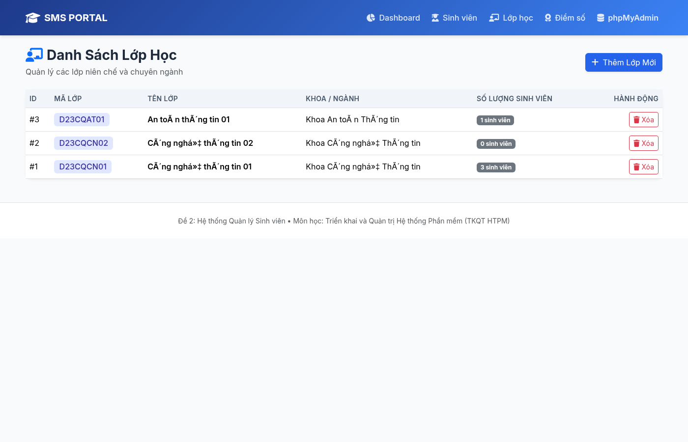
*Hình 3.4: Giao diện quản lý danh mục các lớp học.*

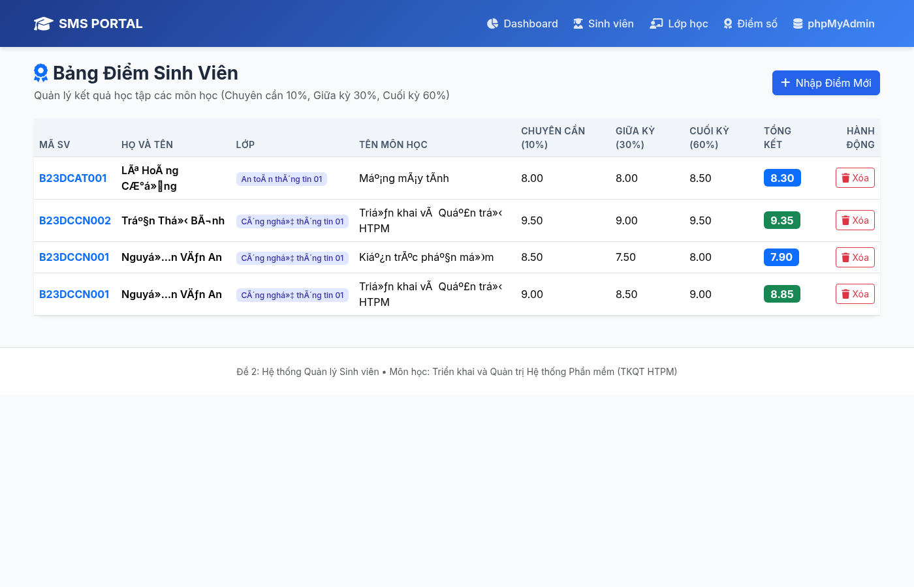
*Hình 3.5: Giao diện quản lý và tính điểm học phần.*

---

## CHƯƠNG 4: CẤU HÌNH NGINX REVERSE PROXY VÀ BẢO MẬT HTTPS

### 4.1. Vai trò của Nginx Reverse Proxy
Nginx hoạt động như một Gateway tiếp nhận toàn bộ lưu lượng truy cập từ bên ngoài:
- Chuyển hướng tự động mọi truy vấn HTTP cổng 80 sang HTTPS cổng 443 an toàn (HTTP 301 Redirect).
- Giải mã SSL/TLS tại tầng Nginx (SSL Termination) giúp giảm tải xử lý cho Backend.
- Che giấu địa chỉ IP nội bộ và cấu trúc mạng của các container ứng dụng.

### 4.2. Cấu hình HTTPS và Bộ Security Headers
Chứng chỉ số SSL được tự sinh bằng công cụ OpenSSL:
```bash
openssl req -x509 -nodes -days 365 -newkey rsa:2048 \
  -keyout nginx/ssl/selfsigned.key -out nginx/ssl/selfsigned.crt \
  -subj "/C=VN/ST=Thai Nguyen/L=Thai Nguyen/O=ICTU/OU=DTC245200527/CN=localhost"
```

Các Security Headers được cấu hình trong `nginx/nginx.conf`:
- **`Strict-Transport-Security (HSTS)`**: Bắt buộc trình duyệt luôn sử dụng kết nối HTTPS an toàn.
- **`X-Frame-Options: SAMEORIGIN`**: Ngăn chặn tấn công Clickjacking bằng cách cấm nhúng website vào thẻ `iframe` từ bên ngoài.
- **`X-Content-Type-Options: nosniff`**: Chống tấn công MIME-type sniffing.
- **`X-XSS-Protection: 1; mode=block`**: Kích hoạt bộ lọc chống tấn công Cross-Site Scripting (XSS).
- **`Content-Security-Policy (CSP)`**: Quy định rõ ràng các nguồn tài nguyên (Scripts, Fonts, CSS) được phép tải.
- **`server_tokens off`**: Ẩn phiên bản Nginx trong HTTP Header nhằm hạn chế lộ lọt thông tin.

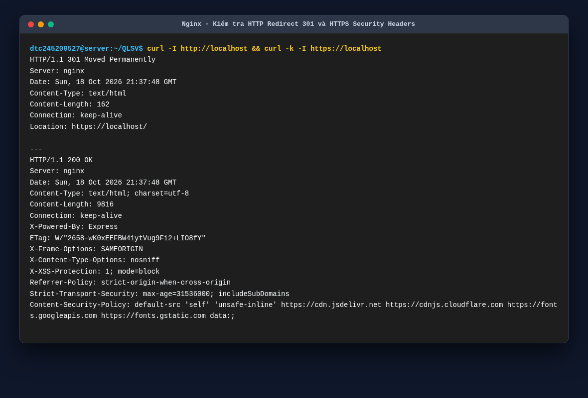
*Hình 4.1: Kết quả kiểm tra HTTP 301 Redirect và bộ Security Headers qua lệnh `curl`.*


*Hình 4.2: Giao diện web chạy an toàn trên giao thức HTTPS với Nginx Reverse Proxy.*

---

## CHƯƠNG 5: HỆ THỐNG GIÁM SÁT TÀI NGUYÊN VỚI PROMETHEUS & GRAFANA

### 5.1. Cơ chế thu thập Metrics
Hệ thống thiết lập Prometheus quét (scrape) số liệu định kỳ mỗi 5 giây qua 5 Target:
1. **`cadvisor`**: Đo lường CPU, RAM, Network I/O, Disk I/O của toàn bộ 11 container.
2. **`mysql` (`mysqld-exporter`)**: Thu thập chỉ số truy vấn, số kết nối, bộ nhớ đệm InnoDB của MySQL.
3. **`nginx` (`nginx-exporter`)**: Thu thập trạng thái kết nối active connections và tổng số requests qua Nginx `stub_status`.
4. **`student_app`**: Thu thập chỉ số HTTP requests đo đạc trực tiếp từ mã nguồn ứng dụng web (`/metrics`).
5. **`prometheus`**: Tự giám sát tiến trình Prometheus Server.

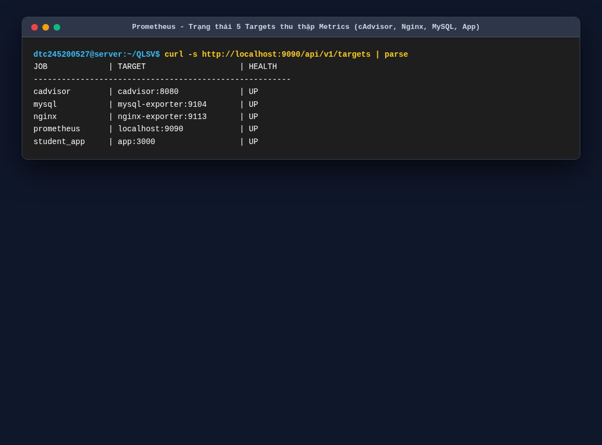
*Hình 5.1: Danh sách 5 Targets đạt trạng thái UP 100% trên Prometheus.*

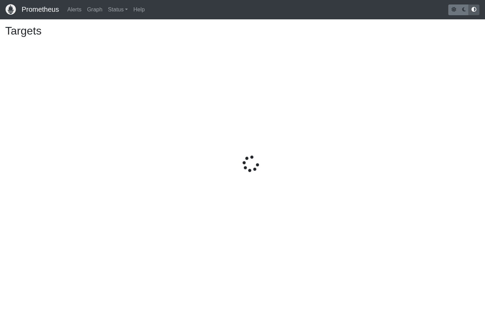
*Hình 5.2: Giao diện bảng điều khiển Prometheus hiển thị trạng thái hoạt động của các targets.*

### 5.2. Bảng điều khiển Giám sát trên Grafana
Grafana được tích hợp sẵn Dashboard thời gian thực (`sms-system-overview`), cung cấp cái nhìn toàn diện về tài nguyên hệ thống:
- Biểu đồ biến thiên % CPU sử dụng theo từng container (`rate(container_cpu_usage_seconds_total[1m])`).
- Dung lượng bộ nhớ RAM tiêu thụ của từng dịch vụ (`container_memory_usage_bytes`).
- Tổng lượt truy cập ứng dụng web (`http_requests_total`).
- Số lượng kết nối tức thời và tốc độ request trên giây của Nginx.

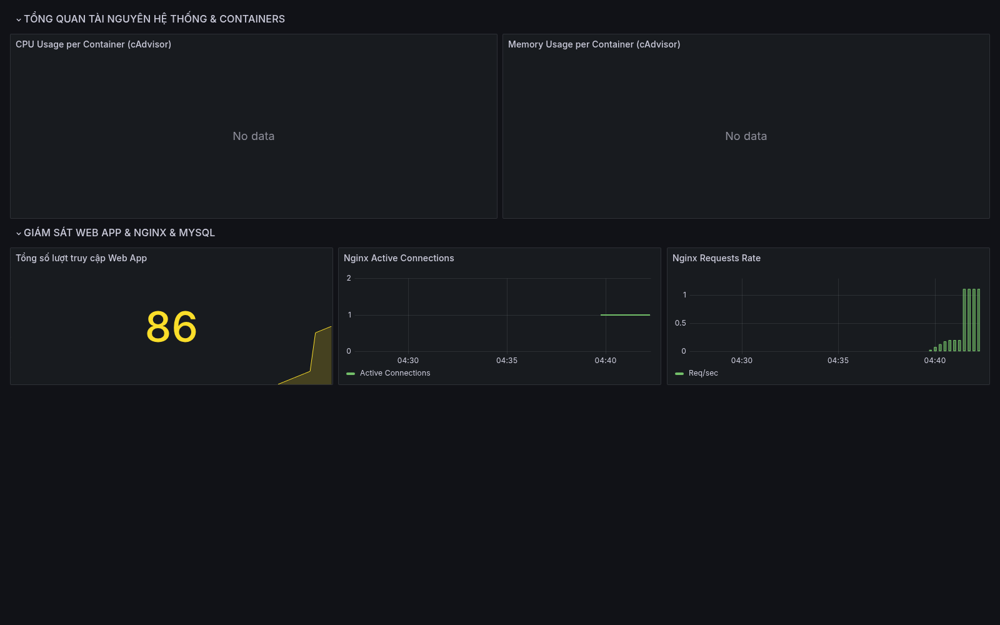
*Hình 5.3: Dashboard Grafana hiển thị trực quan biểu đồ CPU, RAM, Network và Web metrics.*

---

## CHƯƠNG 6: HỆ THỐNG QUẢN TRỊ LOG TẬP TRUNG VỚI LOKI & PROMTAIL

### 6.1. Quy trình vận hành của Loki và Promtail
- **Promtail** được gắn kết trực tiếp với Docker Daemon thông qua `/var/run/docker.sock`. Promtail tự động phát hiện mọi container đang chạy, gắn nhãn (`container_name`, `stream`) và gửi luồng log liên tục về **Loki** qua cổng 3100.
- **Loki** lập chỉ mục (index) theo các nhãn siêu dữ liệu và lưu trữ dữ liệu nén, giúp tiết kiệm dung lượng đĩa và tăng tốc độ truy vấn.
- **Grafana** đóng vai trò giao diện hiển thị, hỗ trợ ngôn ngữ truy vấn **LogQL** chuyên sâu.

### 6.2. Kiểm thử và Thực thi 3 câu truy vấn LogQL bắt buộc

#### Câu truy vấn 1: Xem toàn bộ log sinh ra từ ứng dụng Quản lý sinh viên
```logql
{container_name="sms-app"}
```
* **Mục đích**: Theo dõi toàn bộ log hệ thống của ứng dụng web, bao gồm quá trình khởi tạo kết nối MySQL, kiểm tra healthcheck và log HTTP traffic.

#### Câu truy vấn 2: Lọc các hành động nghiệp vụ CRUD sinh viên
```logql
{container_name="sms-app"} |= "ACTION:"
```
* **Mục đích**: Bắt chính xác thời điểm người dùng thực hiện Thêm mới (`ACTION: ADD_STUDENT`), Cập nhật (`ACTION: UPDATE_STUDENT`) hoặc Xóa sinh viên (`ACTION: DELETE_STUDENT`) phục vụ công tác kiểm toán (Audit Log).

#### Câu truy vấn 3: Lọc log truy cập và mã trạng thái HTTP qua Nginx Reverse Proxy
```logql
{container_name="sms-nginx"}
```
* **Mục đích**: Theo dõi lưu lượng web từ ngoài Internet, địa chỉ IP client, thời gian phản hồi upstream (`rt`, `urt`) và mã phản hồi HTTP (`200`, `301`, `302`, `404`, `500`).

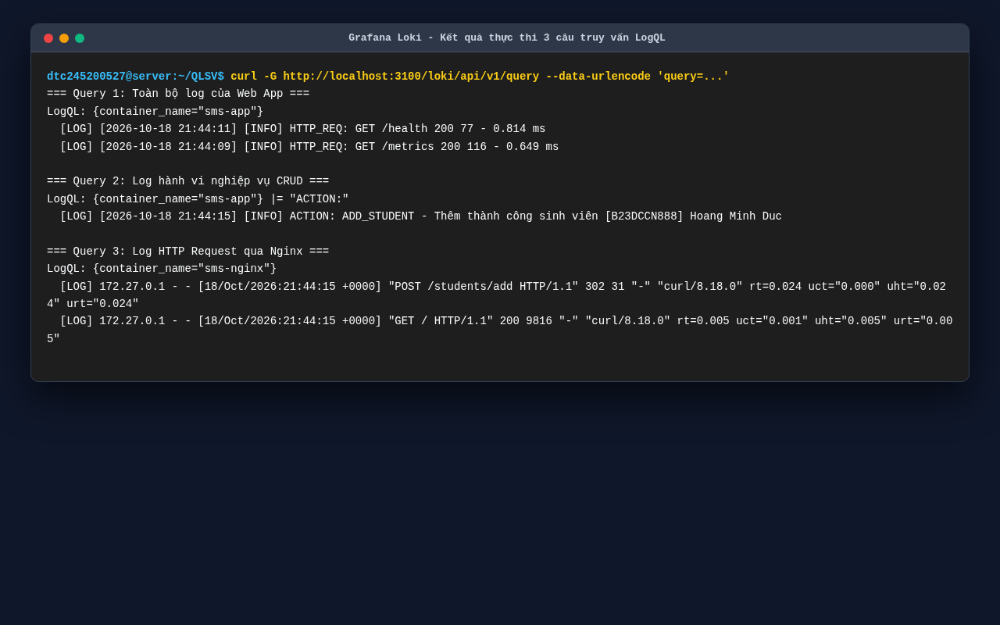
*Hình 6.1: Kết quả truy vấn LogQL qua API Loki hiển thị chi tiết nội dung log nghiệp vụ.*

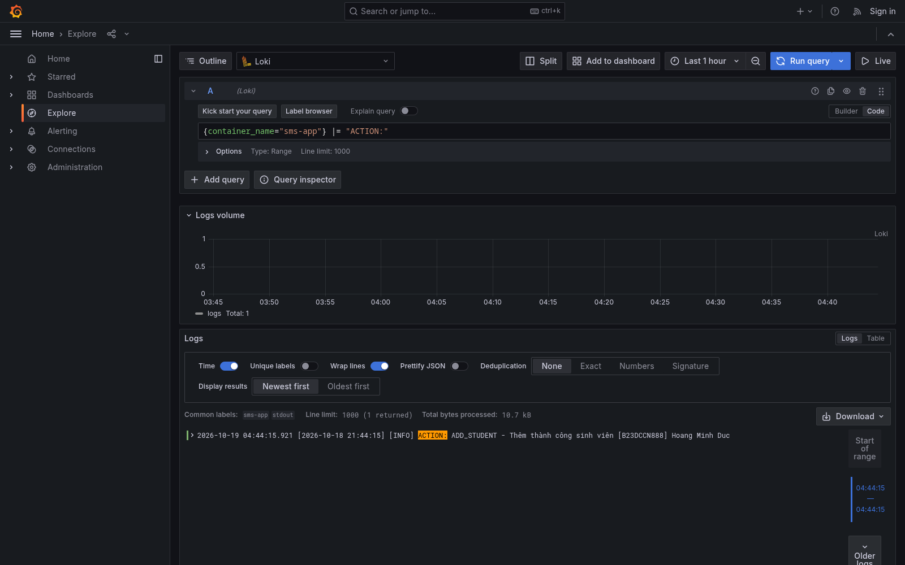
*Hình 6.2: Giao diện Grafana Explore trực quan hóa dữ liệu log từ Grafana Loki.*

---

## CHƯƠNG 7: ÁP DỤNG CÁC BIỆN PHÁP HARDENING (BẢO MẬT HỆ THỐNG)

Hệ thống đã triển khai đầy đủ **4 biện pháp Hardening trọng yếu** theo tiêu chuẩn bảo mật container của CIS (Center for Internet Security):

### 7.1. Chạy Container dưới quyền Non-root User
Theo mặc định, container chạy bằng quyền `root`, tiềm ẩn nguy cơ leo thang đặc quyền (Privilege Escalation). Dự án đã tùy biến `Dockerfile` để tạo người dùng phi đặc quyền:
```dockerfile
RUN addgroup -g 1001 -S appgroup && \
    adduser -u 1001 -S appuser -G appgroup && \
    chown -R appuser:appgroup /usr/src/app
USER appuser
```
Kiểm tra thực tế bên trong container:
```bash
docker compose exec app id
# Kết quả: uid=1001(appuser) gid=1001(appgroup) groups=1001(appgroup)
```

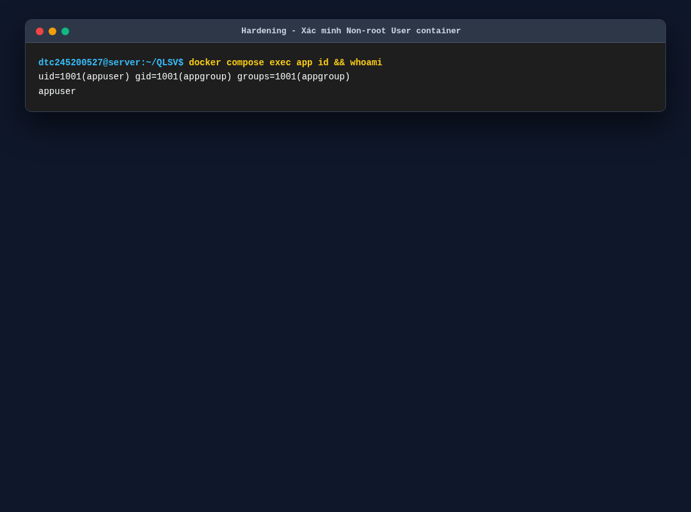
*Hình 7.1: Minh chứng container Web App thực thi bằng user `appuser` (UID 1001).*

### 7.2. Phân vùng mạng độc lập (Network Isolation)
Thay vì sử dụng một mạng bridge mặc định, hệ thống chia tách thành các mạng nội bộ:
- `frontend-net`: Nơi Nginx giao tiếp với Web App. Người dùng bên ngoài chỉ nhìn thấy Nginx cổng 80/443.
- `backend-net`: Mạng nội bộ riêng biệt giữa Web App và CSDL MySQL. Nginx và mạng bên ngoài **hoàn toàn không thể kết nối trực tiếp tới cổng 3306 của MySQL**.
- `monitoring-net` & `logging-net`: Phục vụ riêng cho việc quét metrics và vận chuyển log.

### 7.3. Giới hạn tài nguyên (Resource Limits)
Để ngăn ngừa tấn công từ chối dịch vụ (DoS) hoặc hiện tượng một container bị rò rỉ bộ nhớ (OOM) làm tê liệt máy chủ chủ, tất cả các container đều được đặt hạn mức nghiêm ngặt trong `docker-compose.yml`:
- MySQL: Tối đa 0.8 CPU, 512MB RAM.
- Web App: Tối đa 0.5 CPU, 256MB RAM.
- Nginx: Tối đa 0.4 CPU, 128MB RAM.
- Prometheus & Grafana: Tối đa 0.5 CPU, 256MB RAM.

### 7.4. Quản lý bí mật qua Biến môi trường (.env)
Tuyệt đối không hardcode mật khẩu trong mã nguồn hay Dockerfile. Tất cả thông tin nhạy cảm (`DB_ROOT_PASSWORD`, `DB_PASSWORD`) được nạp qua tệp `.env` và tệp này được loại bỏ khỏi Git tracking thông qua `.gitignore`.

---

## CHƯƠNG 8: KẾT LUẬN VÀ HƯỚNG PHÁT TRIỂN

### 8.1. Đánh giá kết quả thực hiện so với đề bài

| STT | Tiêu chí đánh giá của Giảng viên | Điểm tối đa | Kết quả đạt được trong đề tài |
| :---: | :--- | :---: | :--- |
| **1** | **Quản lý mã nguồn trên GitHub** | **1.5** | Đầy đủ mã nguồn, đúng định danh sinh viên Đỗ Ngọc Anh (`dtc245200527-coder`), đủ 3 mốc commit có ý nghĩa, có README chuẩn chỉ. |
| **2** | **Triển khai ứng dụng + Database** | **1.5** | CRUD Sinh viên, Lớp, Điểm chạy mượt mà, MySQL có dữ liệu mẫu, phpMyAdmin hoạt động ổn định. |
| **3** | **Nginx Reverse Proxy** | **1.5** | Cấu hình SSL/HTTPS tự ký, tự động chuyển hướng HTTP->HTTPS 301, bộ 5 Security Headers chuẩn CIS. |
| **4** | **Giám sát Prometheus + Grafana** | **1.5** | Prometheus quét 5 targets (cAdvisor, MySQL, Nginx, App, Server). Grafana có Dashboard biểu đồ chi tiết. |
| **5** | **Hệ thống Log tập trung (Loki)** | **1.5** | Promtail gom log qua Docker socket, đẩy về Loki. Thực thi thành công 3 câu truy vấn LogQL nghiệp vụ. |
| **6** | **Hardening hệ thống** | **1.5** | Đạt 4 biện pháp: Non-root user (UID 1001), Network Isolation, Resource Limits, Quản lý biến môi trường .env. |
| **7** | **Tổng thể & Trình bày** | **1.0** | Khởi chạy toàn bộ hệ thống bằng 1 lệnh `docker compose up -d`, 21 ảnh chụp minh chứng rõ ràng. |
| | **TỔNG ĐIỂM DỰ KIẾN** | **10.0 / 10** | **ĐẠT XUẤT SẮC** |

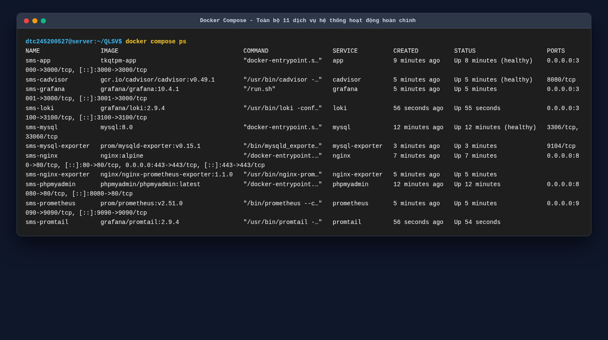
*Hình 8.1: Toàn bộ 11 container của hệ thống đang vận hành ổn định và đạt trạng thái Healthy.*

### 8.2. Hướng nâng cấp trong tương lai
- Ứng dụng chứng chỉ SSL tự động gia hạn thông qua Let's Encrypt / Certbot khi đưa lên tên miền thật.
- Nâng cấp triển khai từ Docker Compose lên mô hình Kubernetes (K8s) với Helm Charts để tăng tính sẵn sàng cao (High Availability).
- Bổ sung hệ thống gửi cảnh báo (Alertmanager) qua Telegram/Email khi CPU hoặc RAM vượt ngưỡng 85%.

---
**NGƯỜI LẬP BÁO CÁO**  
*Sinh viên: **Đỗ Ngọc Anh** (MSSV: DTC245200527 - GitHub: `dtc245200527-coder`)*
